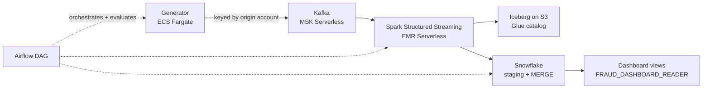

<!-- path: README.md -->
# Real-time Transaction Fraud & AML Monitoring Pipeline

A streaming pipeline that simulates mobile-money transaction traffic, detects fraud and
money-laundering patterns in near real time, and lands the results in Snowflake for
investigator dashboards. It is both a portfolio project and a university group project; this
repository holds the pipeline.

**Status:** pipeline, landing, evaluation harness, dashboard views and CD are done. A full
6.36M-row replay has been verified end to end on AWS. The real ML model and the first live
Airflow evaluation run are pending (see [Evaluation](#evaluation)).

## Architecture



## Tech stack

| Layer | Technology |
|---|---|
| Streaming | Kafka (MSK Serverless, IAM auth), Spark 4.0.2 Structured Streaming |
| Compute | EMR Serverless (emr-spark-8.0.0), custom image on ECR |
| Storage | Apache Iceberg on S3 (Glue Data Catalog) |
| Serving | Snowflake (native tables + views) |
| Orchestration | Airflow 3 (local Docker, LocalExecutor) |
| Infrastructure | Terraform, remote state in S3 with native locking |
| CI/CD | GitHub Actions, OIDC to AWS |
| Language | Python 3.12, PySpark |

## Detection

Detectors run in one Spark Structured Streaming job:

- **Structuring:** repeated just-under-threshold transfers per account. 15-minute sliding window.
- **Velocity:** transaction bursts per account. 1-minute sliding window.
- **Geo anomaly:** impossible travel using speed-based haversine distance, with per-account
  state (`applyInPandasWithState`).
- **ML scoring:** a model loaded through a versioned contract (`spark/model_contract.py`,
  `docs/model_contract.md`). A stub model ships for testing; the real model plugs in without
  pipeline changes.
- **Tripwires:** batch parity ledger, duplicate transaction IDs, watermark lag and landing
  parity checks run alongside the detectors.

Sliding windows are used because tumbling windows split a burst across a window boundary.

## Data model and idempotency

- **Iceberg** (system of record): `transactions` and `alerts`, partitioned by day and hour on
  `event_time`.
- **Snowflake** (serving layer): `TRANSACTIONS_RECENT` and `ALERTS`, a 7-day purge task on
  `INGESTED_AT`. Full history stays in Iceberg.
- **Idempotent sinks:** every write is an insert-only `MERGE` with in-batch deduplication, so a
  replayed batch is safe.
- **Alert keys:** `alert_id` is a deterministic hash.
  - Structuring and velocity: rule + account + window start and end.
  - Geo: rule + transaction ID.
  - ML: rule + transaction ID + model version.
- Overlapping sliding-window alerts stay as separate rows and are collapsed in the dashboard views.

## Infrastructure and CI/CD

- **Terraform:** S3 buckets (raw, curated), ECR with immutable tags, EMR Serverless application,
  a dedicated VPC, MSK Serverless, Glue database, IAM roles and the Fargate generator.
- **Networking:** private subnets with an S3 gateway endpoint and interface endpoints for ECR,
  STS, CloudWatch Logs, Glue and Secrets Manager. A NAT gateway provides Snowflake egress.
- **CI** (`ci.yml`): lint and tests, `terraform plan` through a plan-only OIDC role, and hadolint.
- **CD** (`cd.yml`): image-only. After CI passes on `main`, a run waits for approval in the
  `production` GitHub Environment, then builds and pushes the EMR image tagged with the commit
  SHA and updates the EMR application to it. Terraform apply is deliberately not part of CD,
  because MSK, endpoints and NAT are applied and destroyed per run.
- **Auth:** GitHub OIDC with separate CI (plan-only) and CD (ECR push and EMR update) roles.

## Evaluation

- **Split:** the ML model trains on PaySim steps 1-520 (about 70%). Evaluation replays later
  steps (`--min-step`, default 521) plus injected labelled patterns.
- **Airflow DAG** (`airflow/dags/fraud_replay_eval.py`): `check_msk`, `run_generator`,
  `start_emr_job`, `wait_for_landing`, `evaluate`, `cancel_emr_job`.
- **Metrics:** transaction-level precision, recall, F1 and false-positive rate; per-pattern
  recall; per-rule alert precision.

| Metric | Result |
|---|---|
| Precision | _pending: real model_ |
| Recall | _pending: real model_ |
| F1 | _pending: real model_ |

## Dashboard views

Five Snowflake views in `snowflake/views/` over `ALERTS` and `TRANSACTIONS_RECENT`:
`V_ALERT_INCIDENTS`, `V_ALERTS_FEED`, `V_TRANSACTIONS_SCORED`, `V_ALERT_SUMMARY_HOURLY` and
`V_ACCOUNT_RISK`. The `FRAUD_DASHBOARD_READER` role can read only these views. Connection
settings and column definitions are in `docs/dashboard_contract.md`.

_Dashboard screenshots: pending._

## Local setup

- Install `requirements.txt` and `requirements-dev.txt` in a Python 3.12 virtual environment.
- Run a local Kafka broker (`apache/kafka:3.9.0`) as the dev loop.
- Recreate the `transactions` topic before each generator run, and clear
  `data/checkpoints/detection` and `data/iceberg` between runs.
- Local runs use a Hadoop Iceberg catalog; AWS runs use Glue (`ICEBERG_CATALOG_TYPE`).
- Snowflake landing is off when `SNOWFLAKE_ACCOUNT` is empty.
- Tests: `pytest`. Lint: `black` and `flake8 --max-line-length 150`.
- AWS runs: `scripts/start_emr_job.sh <msk-bootstrap-brokers>`.

## Cost and teardown

MSK, interface endpoints and the NAT gateway bill hourly. The workflow per AWS run is:

- Targeted `terraform apply` for MSK, interface endpoints and NAT.
- Run the generator task, then the EMR job.
- Targeted `terraform destroy` of the same resources.

The EMR application auto-stops after 15 minutes idle. The S3 buckets, ECR repositories, IAM
roles and the state bucket stay in place between runs.

## Design decisions

- **Kafka over Kinesis, MSK Serverless over self-hosting:** broker operations add no learning
  value here.
- **Iceberg as system of record, Snowflake as serving layer:** cheap full history, small and
  fast serving tables.
- **NAT over PrivateLink:** the Snowflake account is in another AWS region than the VPC.
- **No dbt:** Spark handles the streaming transforms and the dashboard views are plain SQL.
- **Scoring inside `foreachBatch`:** the scoring pandas UDF failed during planning in the
  streaming query on EMR, so it runs inside the batch writers.
- **Baked-in JARs:** all connectors are in the EMR image because the workers have no general
  internet access during image start.

## Repository layout

```text
generator/              transaction generator and injectors
spark/                  detectors, scoring, landing, job entry point
airflow/                Dockerfile and evaluation DAG
snowflake/views/        dashboard views and grants
terraform/              infrastructure, CI role and CD role
docker/emr/             EMR Serverless image
docs/                   model contract, dashboard contract
scripts/                EMR job launcher
tests/                  unit tests
.github/workflows/      CI and CD
```

## Team

- **Pipeline** (this repository): ingestion, detection, landing, infrastructure, CI/CD, evaluation.
- **ML model:** two teammates, delivered against the model contract.
- **Dashboard:** one teammate, built against the dashboard contract.